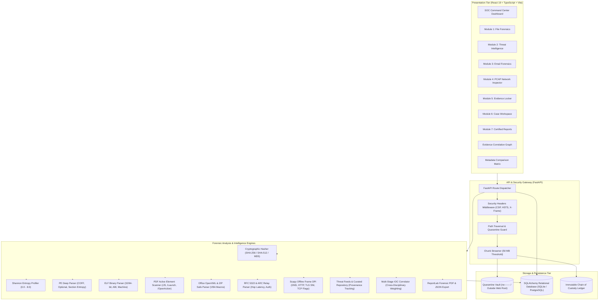
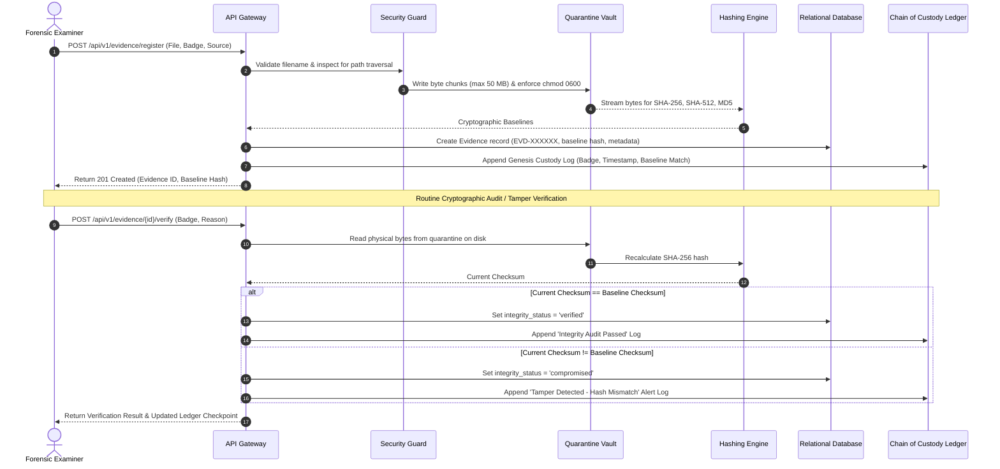

# TRACEX System Architecture & Threat Model

**Platform**: TRACEX Digital Forensics & Threat Intelligence Platform  
**Tagline**: *Investigate. Analyze. Correlate. Discover.*  
**Standard Compliance**: ISO/IEC 27037 (Digital Evidence Handling), RFC 5322, RFC 7208, RFC 6376, RFC 7489, RFC 8617  

---

## 1. Architectural Principles

TRACEX is designed with a defense-in-depth posture tailored specifically for forensic evidence processing and incident triage:

1. **Zero-Execution Quarantine Sandbox**: Uploaded forensic artifacts are stored strictly outside the public web root in an isolated directory (`/backend/storage/quarantine`) with path-traversal countermeasures, execution restrictions (`rw-------` / `0o600`), and safe byte streaming.
2. **Cryptographic Integrity & Chain of Custody**: Every artifact is fingerprinted on acquisition with SHA-256, SHA-512, and MD5 hashes. Real-time on-disk audit checks recalculate checksums to detect physical file tampering or bit-rot.
3. **Strict Epistemic Separation**: Analysis results and reports enforce an explicit distinction between:
   - **Observed Facts**: Cryptographic baselines, packet payload bytes, verified header structures.
   - **External Threat Intelligence**: Curated and live reputation records with provider provenance and retrieval timestamps.
   - **Analyst Interpretations**: Deductive hypotheses and investigative notes.
4. **Non-Attribution Standard**: Metadata anomalies, high Shannon entropy, and file extension mismatches are structural heuristics and are never claimed as definitive malware detection without dynamic behavioral confirmation or reverse engineering.

---

## 2. High-Level System Architecture

---

## 3. Evidence Lifecycle & Chain of Custody Sequence

The diagram below illustrates the complete lifecycle of a digital evidence artifact from physical acquisition through cryptographic verification and formal custody transfer:

---

## 4. Multi-Stage IOC Correlation Architecture

```mermaid
flowchart LR
    subgraph Inputs["Heterogeneous Evidence Sources"]
        F1["Quarantined Executable (File Strings)"]
        F2["Network Capture (PCAP Outbound Sessions)"]
        F3["Phishing Email (Relay Hops & URLs)"]
    end

    subgraph Correlator["TraceX IOC Correlation Engine"]
        Extractor["Indicator Normalization & Type Identifier"]
        Aggregator["Cross-Source Corroboration Matrix"]
        Scorer["Weighted Confidence Scoring"]
        TriCat["Evidentiary Tri-Categorizer"]
    end

    subgraph Outputs["Tri-Categorized Findings"]
        V1["[VERIFIED EVIDENCE] Directly Observed in Local Quarantined Artifacts"]
        V2["[EXTERNAL INTEL] Matched Historical Repositories with Timestamps"]
        V3["[HEURISTIC OBSERVATION] Statistical Anomalies Requiring Validation"]
    end

    Inputs --> Extractor
    Extractor --> Aggregator
    Aggregator --> Scorer
    Scorer --> TriCat
    TriCat --> Outputs
```

---

## 5. STRIDE Threat Model & Countermeasures

| Threat Category | Potential Threat | TraceX Countermeasure |
|---|---|---|
| **Spoofing** | Attacker fabricates evidence records or impersonates authorized examiner. | All custody transactions require mandatory analyst name and badge number. Genesis baseline SHA-256 hash is immutably sealed in the audit ledger upon acquisition. |
| **Tampering** | Evidence files on disk modified or corrupted (bit-rot or unauthorized alteration). | Real-time on-disk integrity audit re-reads quarantined bytes and recalculates SHA-256. Any single-bit discrepancy immediately marks the artifact as `COMPROMISED` and records an immutable tamper alert log. |
| **Repudiation** | Analyst denies transferring evidence custody or modifying investigation dossier. | Custody transfers record releasing badge, recipient badge, reason, destination vault location, and timestamp in an append-only ledger. |
| **Information Disclosure** | Quarantined malware or sensitive seized artifacts accessed via web root or path traversal. | Uploads stored strictly outside web root. Filenames are stripped of path separators, null bytes, and salted with UUID prefixes. Directory resolution validates that files cannot escape quarantine root. |
| **Denial of Service** | Malformed PCAP files, ZIP bombs, or multi-gigabyte uploads crash the server. | 50 MB hard ceiling on file uploads via streaming. Libpcap packet counter capped at 15,000 frames. ZIP Central Directory inspected without extraction, mitigating decompression bombs. |
| **Elevation of Privilege** | Attacker uploads executable (.exe/.elf) and triggers execution via the backend host. | Quarantined files are stored with non-executable permissions (`chmod 0o600`). The backend performs purely static stream analysis; no shell commands (`os.system`, `subprocess`) or interpreters are ever executed on uploaded files. Docker container runs under non-root user `tracex` (UID 1001). |

---

## 6. Defensive Forensic Engineering Guidelines

1. **Non-Attribution Guarantee**: File extension mismatches, high Shannon entropy, and suspicious ports are structural indicators. TraceX never labels a sample as malware based solely on metadata.
2. **Provenance Transparency**: External threat intelligence always cites the provider, retrieval timestamp, and query status. Data is never simulated or fabricated.
3. **Auditable Custody**: Evidence is never overwritten or deleted silently. All transfers and integrity checks are cryptographically verifiable.
