# TRACEX System Architecture & Threat Modeling

## Overview & Core Philosophy

**TRACEX** (*Investigate. Analyze. Correlate. Discover.*) is an extensible, defensive-only digital forensics and threat intelligence platform designed for SOC analysts, DFIR specialists, and cybersecurity researchers.

The platform is built on three foundational security tenets:
1. **Zero-Execution Quarantine Boundary**: Uploaded forensic artifacts are stored strictly outside the public web root in an isolated directory with path-traversal countermeasures, execution restrictions, and safe byte streaming.
2. **Cryptographic Integrity & Chain of Custody**: Every artifact is fingerprinted on acquisition with SHA-256, SHA-512, and MD5 hashes. Real-time on-disk audit checks recalculate checksums to detect physical file tampering or bit-rot.
3. **Strict Epistemic Separation**: Analysis results and reports enforce explicit distinction between **Observed Facts** (e.g., cryptographic baselines, packet payload bytes, header matches), **External Threat Intelligence** (curated and live reputation records with provider provenance), and **Analyst Interpretations** (deductive hypotheses).

---

## High-Level Architecture Diagram

```mermaid
flowchart TD
    subgraph Frontend["Frontend Tier (React + TypeScript + Vite)"]
        UI[SOC Command Center Dashboard]
        M1[Module 1: File Forensics]
        M2[Module 2: Threat Intelligence]
        M3[Module 3: Email Forensics]
        M4[Module 4: PCAP Network Inspector]
        M5[Module 5: Evidence Locker]
        M6[Module 6 & 7: Cases & Report Generator]
    end

    subgraph API["Backend API Gateway (FastAPI + Pydantic)"]
        Router[FastAPI Route Dispatcher]
        SecurityUtil[Path Traversal & Quarantine Guard]
        StorageController[Resource Limits & Chunk Streamer]
    end

    subgraph Engines["Forensic Analysis & Intelligence Engines"]
        HashEngine[Cryptographic Hasher: MD5 / SHA-256 / SHA-512]
        EntropyEngine[Shannon Entropy Profiler]
        SigEngine[Binary Magic Header Registry]
        YARAEngine[Rule Matcher & Threat Patterns]
        EMLEngine[RFC 822 / SPF / DKIM / DMARC Parser]
        PCAPEngine[Scapy Offline Frame Dissector]
        IntelEngine[Live Threat Feeds + Curated Indicators]
        ReportEngine[ReportLab Forensic PDF / JSON Generator]
    end

    subgraph Storage["Persistent Quarantine & Auditable Database"]
        Quarantine[(Quarantine Vault / No Web Root)]
        SQLiteDB[(SQLite / PostgreSQL Relational DB)]
        Ledger[(Immutable Chain of Custody Ledger)]
    end

    UI --> Router
    M1 --> Router
    M2 --> Router
    M3 --> Router
    M4 --> Router
    M5 --> Router
    M6 --> Router

    Router --> SecurityUtil
    SecurityUtil --> StorageController
    StorageController --> Quarantine

    Router --> Engines
    Engines --> HashEngine
    Engines --> EntropyEngine
    Engines --> SigEngine
    Engines --> YARAEngine
    Engines --> EMLEngine
    Engines --> PCAPEngine
    Engines --> IntelEngine
    Engines --> ReportEngine

    Router --> SQLiteDB
    Engines --> SQLiteDB
    StorageController --> Ledger
```

---

## Defensive Security Architecture & Countermeasures

### 1. Quarantine & Path Traversal Mitigation
- All uploaded files are sanitized using `sanitize_filename()` which strips directory separators (`/`, `\`), path traversal patterns (`..`), null bytes (`\x00`), and non-printable characters.
- Quarantined files are saved using a cryptographic UUID prefix:
  `quarantine_dir / f"{uuid.uuid4().hex[:12]}_{clean_name}"`
- Path traversal verification asserts `target_path.resolve().relative_to(quarantine_dir.resolve())`.

### 2. Denial of Service & Resource Exhaustion Controls
- **File Upload Capping**: Enforced 50 MB threshold via chunk streaming.
- **Packet Limiter**: PCAP parser halts processing at 15,000 packets to prevent memory exhaustion.
- **Strings Extractor**: Caps extraction at 60 strings with minimum character thresholds to avoid buffer bloat.
- **Batch Intel Limits**: Caps batch IOC lookups at 25 items per request.

### 3. Threat Intelligence Attribution & Transparency
- External intelligence lookups never fabricate data.
- Every external report preserves:
  - Exact data provider (e.g. VirusTotal v3, AbuseIPDB, TRACEX Curated Database).
  - Exact retrieval timestamp in UTC.
  - Raw query status and reference URLs.
